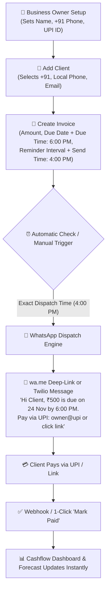

# AlertPe (CashPilot) — Comprehensive Project Documentation & Master Blueprint

> **File:** `know.md`  
> **Last Updated:** November 2026  
> **Repository:** [Garvit-png/AlertPe](https://github.com/Garvit-png/AlertPe.git)  
> **Status:** Production-Ready MVP / Hackathon Demo Ready  
> **Test Status:** 19/19 Unit Tests Passing (100% Core Engine Coverage)

---

## 1. Project Overview (Kya Project Hai?)

**AlertPe** (internally code-named *CashPilot*) is an ultra-minimalist financial back-office and cashflow automation platform built specifically for **Indian freelancers, independent consultants, agencies, and micro-business solo entrepreneurs**.

### The Core Problem It Solves:
In India, solo professionals and small service businesses struggle with:
1. **Late Client Payments & Awkward Chasing:** Owners feel hesitant or forget to regularly follow up on pending invoices.
2. **Missing Exact Deadlines:** Invoices usually just have a date, but no specific deadline hour (e.g., "pay before 4:00 PM today").
3. **Friction in Payment Collection:** Clients receive boring invoices and don't get a direct 1-click UPI or payment link on their phone.
4. **Cashflow Blindness:** Owners do not know if they will have enough bank balance 15 or 30 days from now after paying upcoming bills (rent, software subscriptions, contractor fees, taxes).

### The AlertPe Solution:
- **Instant Invoicing with Exact Deadline:** Set an invoice due date along with an **Exact Due Time** (e.g., 24 Nov 2026 by 6:00 PM) and a **Daily Reminder Dispatch Time** (e.g., every day at 4:00 PM).
- **Automated WhatsApp Follow-ups:** 1-click direct WhatsApp links (`wa.me`) or automated background messaging with pre-formatted, polite yet firm Hindi/English reminder messages.
- **Dynamic Payment Links & Direct UPI:** Generates instant UPI deep-links (`upi://pay?pa=...&am=...`) and mock payment gateway URLs embedded straight into the WhatsApp message.
- **30-to-90 Day Predictive Cashflow Engine:** Calculates daily running balance based on invoice inflows vs. bill outflows, pinpointing exact future deficit dates.
- **"What-If" Scenario Simulator:** Visually simulates: *"What happens if Client X pays 10 days late?"* so owners can plan expenses proactively.
- **Distraction-Free Anti-AI UI:** Clean, human-designed, single-page light mode interface (`#fafafa` canvas, `#ffffff` cards, crisp zinc typography, zero gradients, zero emojis in buttons).

---

## 2. Technology Stack (Kisme Bana Hai?)

| Layer | Technology | Version | Purpose |
|---|---|---|---|
| **Runtime** | Node.js (ES Modules) | `>=20.0.0` | High-performance asynchronous JavaScript engine |
| **Backend Framework** | Express.js | `^4.19.2` | RESTful API server, routing, middleware |
| **Database & ODM** | MongoDB & Mongoose | `^8.4.1` | Document database, connection pooling, schema validations, virtual fields |
| **Embedded DB / Fallback** | `mongodb-memory-server` & Custom In-Memory Store | `^11.4.0` | Instant zero-config local testing and serverless offline mode |
| **Serverless Deployment** | Vercel Serverless Functions | AWS Lambda | Scalable serverless API hosting with CDN edge caching |
| **Validation** | Zod | `^3.23.8` | Strict request schema validation for inputs and query params |
| **Security & Hardening** | Helmet, CORS, Express-Rate-Limit | `^7.1.0` | HTTP headers hardening, origin restrictions, tiered rate-limiting |
| **Date & Time Manipulation** | `date-fns` & `date-fns-tz` | `^2.30.0` | Timezone-aware date calculations, 12h/24h conversions, exact minute deadlines |
| **Logging** | Pino & Pino-Pretty | `^9.1.0` | Structured JSON logging in production, colorized local development logs |
| **Frontend Reactive Core** | Alpine.js (via CDN) | `v3.x` | Minimalist reactive state management, modal controllers, tabs |
| **Frontend Styling** | Tailwind CSS (via CDN) | `v3.x` | Pure light-mode design system (`#fafafa`, `#e4e4e7`, `zinc-900`) |
| **Icons & Visuals** | Lucide Icons & Chart.js | Latest CDN | Clean line icons, interactive cashflow trajectory line charts |
| **Payments Integration** | Razorpay SDK & UPI Deep-Link Protocol | `^2.9.4` | Native UPI string generation (`upi://pay`), payment links, webhook verification |
| **Messaging Engine** | WhatsApp Click-to-Chat & Twilio API | `^5.1.1` | Direct WhatsApp deep linking and programmable SMS/WhatsApp dispatch |
| **Scheduling** | `node-cron` | `^3.0.3` | Scheduled daily reminder checks and overdue invoice monitors |
| **Test Suite** | Native Node Test Runner (`node:test`, `node:assert`) | Built-in | Fast unit test execution (19 tests in 148ms) |

---

## 3. Project Directory Structure

```
AlertPe-1/
├── api/
│   └── index.js              # Vercel Serverless Function entrypoint (exports Express app)
├── middleware/
│   ├── errorHandler.js       # Global centralized error handling & custom error classes
│   ├── rateLimiter.js        # Tiered API rate limiting (global, mutations, webhooks)
│   └── validate.js           # Zod validation middleware (Invoices, Clients, Bills, Profile)
├── models/
│   ├── index.js              # Central model registry & export
│   ├── Bill.js               # Accounts Payable schema (Vendors, Rent, Subscriptions)
│   ├── Client.js             # Client records schema with virtual metrics (totalOwed, pendingCount)
│   ├── Invoice.js            # Invoices schema with dueTime, reminderTime, status & virtuals
│   └── Profile.js            # Business owner profile, UPI ID, sender number, settings
├── public/
│   ├── index.html            # Main SPA dashboard, modals, single-page settings & client views
│   └── js/
│       └── app.js            # Alpine.js reactive store, API integration, phone parser, state
├── routes/
│   ├── auth.js               # Business setup, owner profile, phone settings, gate toggle
│   ├── bills.js              # Bills CRUD, mark-as-paid, categories, outflow tracking
│   ├── clients.js            # Client records CRUD, client search, client invoice aggregation
│   ├── dashboard.js          # KPI stats (owed, pending, overdue, runway) and cashflow forecast
│   ├── invoices.js           # Invoice CRUD, status update, UPI link generator, time handler
│   ├── reminders.js          # WhatsApp reminder dispatch, manual trigger, interval auto-check
│   ├── simulations.js        # What-If cashflow forecasting simulation endpoint
│   └── webhooks.js           # Payment gateway webhook handlers with HMAC verification
├── scripts/
│   └── seed.js               # Realistic Indian business demo data (Clients, Invoices, Bills)
├── services/
│   ├── cashflow-engine.js    # Pure deterministic mathematical engine for 30-day forecast
│   ├── cron-jobs.js          # node-cron scheduled tasks for automatic reminder triggers
│   ├── db.js                 # MongoDB connection pooler & in-memory memory server fallback
│   ├── offline-store.js      # Zero-crash memory persistence when running without remote DB
│   ├── payment-gateway.js    # Razorpay SDK integration with mock payment link fallback
│   ├── sse.js                # Server-Sent Events real-time event broadcaster
│   └── whatsapp.js           # Twilio client & WhatsApp direct link URL builder with exact times
├── tests/
│   └── cashflow-engine.test.js # 19 unit tests for cashflow computations & edge cases
├── utils/
│   ├── dateUtils.js          # Timezone helpers, IST formatters, deadline calculators
│   ├── invoiceNumber.js      # Sequential atomic invoice number generator (INV-YYYY-XXXXX)
│   ├── logger.js             # Shared Pino logger instance
│   └── webhookVerify.js      # Cryptographic SHA256 signature verification for payments
├── .env.example              # Environment variables template
├── checkpoint.md             # Development milestones and coding logs
├── know.md                   # THIS FILE: Complete master architecture documentation
├── package.json              # Project metadata, dependencies, and NPM scripts
├── server.js                 # Express server initialization, middleware stack & local listener
└── vercel.json               # Vercel deployment rewrites, CDN routing & static mapping
```

---

## 4. What Has Been Built (Kya Kya Bana Hai?)

### 1. Minimalist Anti-AI User Interface
- **Pure Light Palette:** Strictly `#fafafa` background with pure `#ffffff` cards and neutral `#e4e4e7` borders. No dark mode toggle, no gradients, and no generic AI emojis.
- **Single-Page No-Scroll Views:** Modals and onboarding pages are designed wide with a balanced 2-column grid to fit standard laptop viewports without awkward page scrolling.
- **Top Navigation Tabs:** Clean tab switching between **Dashboard**, **Invoices**, **Bills**, **Clients**, **Simulator**, and **Settings**.

### 2. Business Profile & Optional Sign-in Gate
- **Owner Profile Setup:** Captures Business Name, Owner Name, Notification WhatsApp Phone, Personal UPI ID (`username@okaxis` / `name@upi`), and Currency (`INR ₹`).
- **Flexible Gate Control:** Sign-in gate is **OFF by default** so you can immediately inspect the dashboard without friction. It can be toggled ON with a 1-click switch in Settings whenever strict authentication gating is required.

### 3. Universal Country Code Selector (`+91` India First)
- Pre-selected `[🇮🇳 +91]` dropdown paired with a clean 10-digit phone input field across **100% of phone number fields** in the application (Client Modal, Owner Settings, etc.).
- Automatically sanitizes and formats inputs into international E.164 standard (`+919876543210`) so users never have to manually type `+91`.

### 4. Advanced Invoicing with Exact Deadline & Dispatch Time
- **Exact Due Time:** In addition to the Due Date, users can specify the exact time payment is expected (e.g., `Due Date: 24 Nov 2026`, `Due Time: 18:00` / 6:00 PM).
- **Scheduled Reminder Dispatch Time:** Set the exact hour of the day when automated follow-up messages should be sent (e.g., `Reminder Time: 16:00` / 4:00 PM every day or every 2 days).
- **Invoice Status Lifecycle:** Supports `DRAFT`, `SENT`, `OVERDUE`, `PAID`, and `CANCELLED`.
- **Exact Minute-Level Overdue Evaluation:** Calculates whether an invoice is overdue based on date *and* time.

### 5. Automated WhatsApp Follow-up Engine
- **1-Click WhatsApp Direct Deep Links:** Clicking "Send Reminder" creates an instant `wa.me/<phone>?text=...` URL opening WhatsApp Web or Mobile directly.
- **Intelligent Pre-Filled Message Content:** Automatically includes:
  - Client's name and business name.
  - Invoice Number and Amount in Indian Rupees (`₹`).
  - **Exact deadline display:** *"due on 24 Nov 2026 by 6:00 PM"*.
  - Owner's UPI ID.
  - Direct 1-click payment link.
- **Automatic Interval Routing:** Backend logic checks reminder frequency (`daily`, `every_2_days`, `every_3_days`, `weekly`, `on_due_date`) and dispatch time to ensure messages go out on schedule without manual effort.

### 6. Payment Collection & UPI Links
- **UPI Deep-Linking:** Automatically generates `upi://pay?pa=...&pn=...&am=...&tn=Invoice+INV-...` strings compatible with Google Pay, PhonePe, Paytm, and BHIM.
- **Dynamic Payment Links:** Creates shareable mock payment links (`https://pay.alertpe.in/pay/INV-...`) ready to swap with live payment gateways.

### 7. Client Directory Management
- Full client directory with search, filter, and sorting.
- Shows total amount owed per client and active pending invoices count.
- 1-click navigation to view all invoices belonging to a specific client.

### 8. Accounts Payable & Bills Tracker
- Records outgoing vendor obligations (SaaS, Rent, Subcontractors, Taxes, Utilities, Salaries).
- Tracks due dates and payment statuses (`PENDING`, `PAID`, `OVERDUE`).
- Feeds real-time outflow data directly into the cashflow forecasting engine.

### 9. 30-to-90 Day Cashflow Forecasting Engine
- Deterministic forecasting algorithm implemented in [services/cashflow-engine.js](file:///Users/ajayyadav/AlertPe-1/services/cashflow-engine.js).
- Computes daily expected balance curves:
  $$\text{Balance}_{t} = \text{Balance}_{t-1} + \text{Inflows}_{t} - \text{Outflows}_{t}$$
- Highlights deficit days where projected balance drops below ₹0, giving early warnings before the business runs out of cash.
- **What-If Scenario Simulator:** Allows shifting expected payment dates by $\pm N$ days to simulate delayed client payments.
- **19/19 Unit Tests Passing:** Rigorously tested for month boundaries, leap years, negative balances, crore-scale figures, and simultaneous transactions.

### 10. Resilient Vercel Cloud Serverless Deployment
- Configured for 1-click deployment on Vercel via [vercel.json](file:///Users/ajayyadav/AlertPe-1/vercel.json) and [api/index.js](file:///Users/ajayyadav/AlertPe-1/api/index.js).
- **Graceful In-Memory Fallback:** Built with [services/offline-store.js](file:///Users/ajayyadav/AlertPe-1/services/offline-store.js). If MongoDB Atlas credentials are not yet added in Vercel environment variables, the entire app still loads with zero crashes (`500 FUNCTION_INVOCATION_FAILED` is completely prevented).

---

## 5. End-to-End Workflow Diagram



---

## 6. API Route Reference

| Method | Endpoint | Description | Validation / Schema |
|---|---|---|---|
| `GET` | `/health` | Server health check & environment info | None |
| `GET` | `/api/auth/profile` | Retrieve owner profile & settings | None |
| `POST` | `/api/auth/setup` | Save initial business owner setup | `ownerSetupSchema` |
| `PUT` | `/api/auth/profile` | Update profile, UPI ID, or phone | `ownerSetupSchema` |
| `GET` | `/api/clients` | List all clients with debt summary | Query filters |
| `POST` | `/api/clients` | Create new client record | `createClientSchema` |
| `PUT` | `/api/clients/:id` | Update client details | `updateClientSchema` |
| `DELETE`| `/api/clients/:id` | Delete client (blocked if invoices exist) | Client ID |
| `GET` | `/api/invoices` | List invoices (with search/status filters)| Query filters |
| `POST` | `/api/invoices` | Create invoice with `dueTime` & `reminderTime` | `createInvoiceSchema` |
| `GET` | `/api/invoices/:id` | Get single invoice with UPI link | Invoice ID |
| `PUT` | `/api/invoices/:id` | Update invoice amount or deadline | `updateInvoiceSchema` |
| `POST` | `/api/invoices/:id/mark-paid` | 1-Click mark invoice as paid | Invoice ID |
| `GET` | `/api/bills` | List all accounts payable bills | Query filters |
| `POST` | `/api/bills` | Create vendor bill | `createBillSchema` |
| `POST` | `/api/bills/:id/mark-paid` | Mark bill as paid | Bill ID |
| `GET` | `/api/dashboard/stats` | KPI summary (owed, pending, overdue, runway)| None |
| `GET` | `/api/dashboard/forecast`| 30-day daily cashflow projection data | `days` query param |
| `POST` | `/api/simulations/what-if`| Run scenario shifting client payment dates | `whatIfSchema` |
| `GET` | `/api/reminders/auto-check`| Interval cron check for scheduled WhatsApps | None |
| `POST` | `/api/reminders/trigger-now`| Manually trigger WhatsApp reminder | Invoice ID |
| `POST` | `/api/webhooks/payment` | Razorpay payment confirmation webhook | HMAC verification |

---

## 7. What Remains / Future Roadmap (Kya Kya Reh Gaya Hai?)

While the application is fully functional for local use, demonstrations, and manual WhatsApp link generation, the following items are planned for enterprise-scale SaaS deployment:

### 1. Official Meta WhatsApp Cloud API (Silent Server-to-Server Dispatch)
- **Current State:** Reminders work via instant **1-Click WhatsApp Direct Links** (`https://wa.me/...`) which open WhatsApp Web/Mobile with pre-filled text, plus a Twilio API sandbox abstraction.
- **Remaining Task:** Register an official WhatsApp Business App on Meta Developer Portal, verify business documents, get approved message templates (e.g. `payment_reminder_v1`), and plug in the System User Access Token so messages send completely automatically in the background without opening the browser.

### 2. Live Payment Gateway Keys (Razorpay / Cashfree)
- **Current State:** Dynamic UPI links (`upi://pay`) and mock payment gateway URLs are fully functional. The backend has the complete Razorpay SDK integration (`services/payment-gateway.js`).
- **Remaining Task:** Add live production credentials (`RAZORPAY_KEY_ID`, `RAZORPAY_KEY_SECRET`) to Vercel/server `.env` and set the webhook URL in the Razorpay dashboard pointing to `/api/webhooks/payment`.

### 3. GST-Compliant PDF Invoice Generation
- **Current State:** Invoices are tracked digitally in the database with invoice numbers, line items, and notes.
- **Remaining Task:** Integrate a lightweight PDF generation library (such as `pdfkit` or `@react-pdf/renderer`) to generate downloadable GST tax invoices with HSN/SAC codes, and attach the PDF directly to WhatsApp reminders.

### 4. External Cron Worker for Vercel Serverless
- **Current State:** In persistent node environments (`node server.js`), `node-cron` runs automatically every hour. On Vercel Serverless, processes sleep when there is no incoming traffic.
- **Remaining Task:** Add a `cron` entry in `vercel.json` or configure a free external ping service (like [cron-job.org](https://cron-job.org)) to hit `/api/reminders/auto-check` every hour to trigger scheduled reminders.

### 5. Multi-User SaaS Authentication & Tenancy
- **Current State:** Designed as a dedicated, private back-office for a solo business owner (with an optional 1-click password gate).
- **Remaining Task:** If turning into a public multi-tenant SaaS, add JWT/OAuth2 login with email verification and associate all records (`invoices`, `clients`, `bills`) with an `organizationId`.

### 6. Export to Accounting Software
- **Remaining Task:** Add a 1-click export button to download Invoices and Bills in Excel (`.xlsx`), CSV, or Tally XML format for chartered accountants (CAs).

---

## 8. How to Run Locally

### Prerequisites:
- Node.js `v20.x` or higher
- MongoDB (Optional: if local MongoDB is not running, the app automatically starts an in-memory database with demo data!)

### Installation Steps:
```bash
# 1. Clone the repository
git clone https://github.com/Garvit-png/AlertPe.git
cd AlertPe-1

# 2. Install dependencies
npm install

# 3. Setup environment variables
cp .env.example .env

# 4. Run automated unit tests
npm test

# 5. Populate realistic demo data (Optional)
npm run seed

# 6. Start the development server
npm run dev
# OR start standard production server
npm start
```
The application will be live at: **`http://localhost:3000`**

---

## 9. Deployment on Vercel

The project is already pre-configured for Vercel deployment:
1. Push your changes to GitHub `origin/main`.
2. Connect your GitHub repository on [Vercel](https://vercel.com).
3. In Vercel Project Settings > **Environment Variables**, optionally set:
   - `MONGODB_URI`: Your MongoDB Atlas connection string (`mongodb+srv://...`)
   - `FRONTEND_URL`: Your Vercel production domain
4. Deploy! Static files will be served at edge CDN speed, and API routes will run via the Serverless handler in `api/index.js`.

---

*Authored for AlertPe / CashPilot — November 2026*
